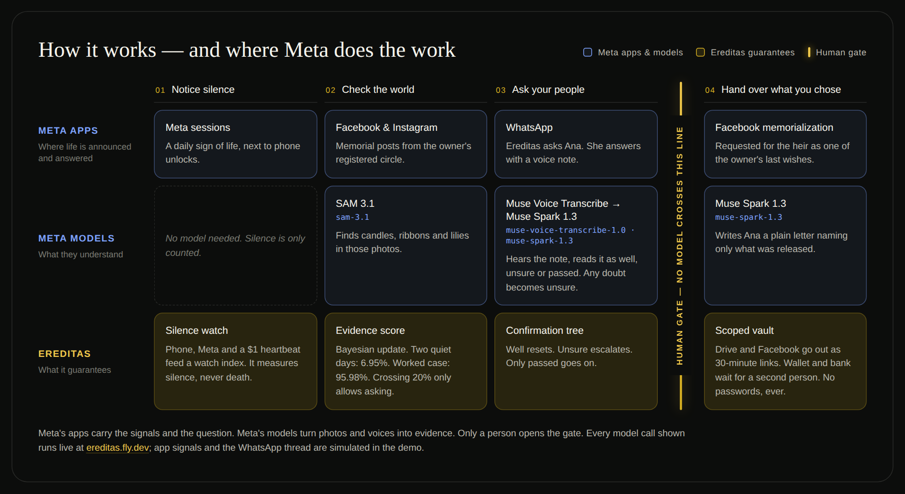

# Ereditas

**AI agents that carry out your digital will — only after the people you trust confirm you're gone.**

Meta Global AI Developer Hackathon 2026 · Indie · Build for Your World

| | |
| --- | --- |
| **Demo video** | https://youtu.be/nwLoM5TS5Aw (English, 2:13) · https://youtu.be/SY3nfJjo7tE (español) |
| **Try it** | https://app.ereditas.com/ (backup: https://ereditas.fly.dev/) — two-minute walkthrough: [`docs/judges.md`](docs/judges.md) |
| **Explainer** | https://ereditas.com/ |
| **Meta models (live)** | SAM 3.1 · Muse Voice Transcribe · Muse Spark 1.3 |

> In 2008 my father died suddenly. To tell his clients what had happened, I
> had to break into his phone. To cancel his subscriptions and reach the
> people who mattered, I had to get into his email. His documents and photos
> sat behind passwords no one had. The legal succession took years; his
> digital life couldn't wait. Back then, automating that was impossible.
> Today, it isn't. — Edwin Kestler



Meta's apps carry the signals and the question (Facebook and Instagram
memorial posts, WhatsApp). Meta's models turn photos and voices into
evidence. Only a person opens the gate; release is scoped, time-limited and
never includes passwords.

## Repository

Idea source: the Grok project at
[grok.com/project/571a21c7-4a9d-42d9-8706-9e5c51dd6e7f](https://grok.com/project/571a21c7-4a9d-42d9-8706-9e5c51dd6e7f?tab=conversations).

Product: a human-confirmed digital estate companion. Idea:
[`ideas/ereditas.md`](ideas/ereditas.md). How to run:
[`docs/companion.md`](docs/companion.md). White paper:
[`docs/Ereditas-White-Paper.pdf`](docs/Ereditas-White-Paper.pdf). Hackathon
notes: [`docs/hackathon.md`](docs/hackathon.md). Doc index:
[`docs/README.md`](docs/README.md). Public GitHub:
[EdwinKestler/ereditas](https://github.com/EdwinKestler/ereditas)
(PolyForm Noncommercial).

## Companion

Two processes. Python owns the algorithms and Meta Model API. The judge UI is
the Pure Minimal Grok shell.

```bash
python3 -m venv .venv
.venv/bin/pip install -e ".[dev]"
cp .env.example .env   # fill locally; never commit
.venv/bin/pytest
./scripts/run-companion.sh
```

Second terminal:

```bash
cd grok_mvp/Ereditas/grok-workspace && npm install && npm run dev
```

Open **http://127.0.0.1:8080**. Vite proxies `/api` and `/static` to FastAPI
on `:8765`. Pulse, Watch, Circle, Vault, Wishes. The ring is a watch index.
Release requires a human **passed**. Demo owner: Elena Reyes.

The bundled Spanish voice notes live under `apps/companion/static/voice/`.
They are real recordings (mono 16-bit PCM WAV, 24 kHz). To replace them, keep
the `ana-passed.wav` and `ana-unsure.wav` filenames and the same format so the
live Muse Voice Transcribe file endpoint accepts them without conversion.

The FastAPI HTML at http://127.0.0.1:8765 still serves the five theme cards.

## Palimnex

Palimnex 2.9.0 is the repository-local memory layer for humans and coding
agents. Search it for methods, examples, tools, and guidelines instead of
rereading the whole tree.

```bash
./scripts/palimnex-setup.sh
palimnex status
palimnex search "ereditas" --limit 8
```

Operator notes: `docs/palimnex.md`. Agent skill: `.agents/skills/source-cache/SKILL.md`.

## ECC workflow skills

A thin ECC v2.2.3 skill pack lives under `.agents/skills/` (search-first,
plan-canvas, tdd-workflow, security-review, security-scan, safety-guard,
codebase-onboarding). Palimnex remains the memory layer. Notes: `docs/ecc.md`.

```bash
npx ecc-agentshield@1.6.0 scan --path /media/kestl/andor/github/ereditas
```

## Layout

| Path | What belongs here |
| --- | --- |
| `ideas/` | Product proposals (local authority) |
| `docs/` | Operator notes, Palimnex, ECC, TDD evidence |
| `docs/plans/` | Human-reviewed plan artifacts |
| `src/ereditas/` | Algorithms, Meta stack, FastAPI |
| `tests/` | pytest (`EREDITAS_OFFLINE=1`) |
| `apps/companion/static/` | Memorial images, theme cards, older HTML UI |
| `grok_mvp/Ereditas/grok-workspace/` | Pure Minimal React shell (`:8080`) |
| `scripts/` | Palimnex setup and `run-companion.sh` |
| `.agents/skills/` | Palimnex skill plus vendored ECC skills |
| `.palimnex.json` | Palimnex project config (commit this) |
| `.palimnex/` | Runtime ledger and Redis (gitignored) |
| `.ecc/` | ECC Memory Vault if ever opted in (gitignored) |
| `AGENTS.md` | Instructions for coding agents |
| `LICENSE` | PolyForm Noncommercial 1.0.0 © 2026 Edwin Kestler |

## License

Original Ereditas code is [PolyForm Noncommercial 1.0.0](LICENSE) © 2026
Edwin Kestler. Personal, research, hobby, school, charity, and government use
is allowed. Commercial use needs a separate grant. Notes:
[`docs/license.md`](docs/license.md).

Vendored ECC skills under `.agents/skills/` remain MIT © 2026 Affaan Mustafa;
see [`.agents/skills/NOTICE.md`](.agents/skills/NOTICE.md).

## Source

Public GitHub: https://github.com/EdwinKestler/ereditas

Project explainer (not the live demo): https://ereditas.com/

Grok project (login required):
https://grok.com/project/571a21c7-4a9d-42d9-8706-9e5c51dd6e7f?tab=conversations
